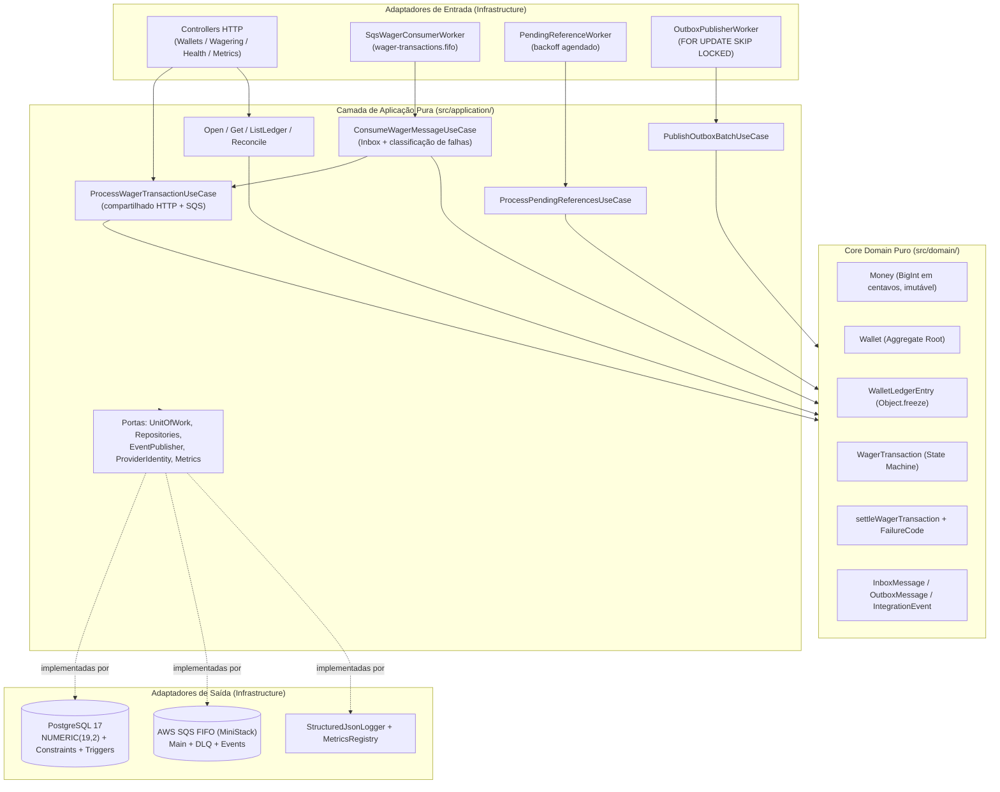
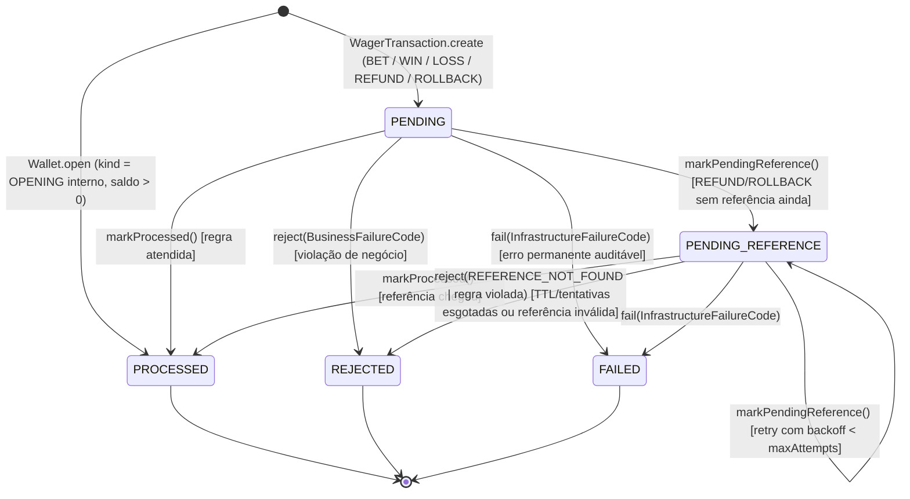
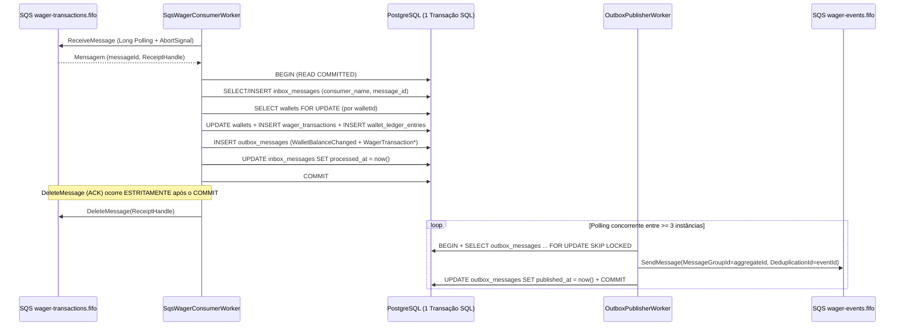
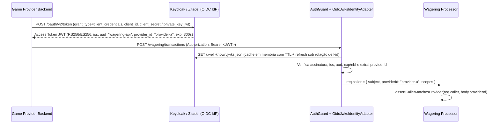

# Arquitetura e Decisões Técnicas — Distributed Wagering Processor

Este documento registra as decisões arquiteturais, invariantes financeiras, algoritmos, políticas de resiliência, trade-offs e limitações conhecidas do **Distributed Wagering Processor** (desafio técnico da **Jungle Gaming** — enunciado original preservado em [`docs/CHALLENGE.md`](./docs/CHALLENGE.md)).

---

## 1. Visão Geral e Fronteiras Arquiteturais (DDD + Hexagonal)

O serviço foi estruturado **de dentro para fora (Domain-First)** em três camadas concêntricas estritas, garantindo que toda regra financeira e invariante de estado viva em TypeScript puro, sem acoplamento a NestJS, TypeORM ou AWS SDK:



### Garantias estruturais de modelagem (§6.0)
- **Zero dependências externas no núcleo**: `src/domain/` e `src/application/` não possuem nenhum `import` ou decorator de `@nestjs/*`, `typeorm` ou `@aws-sdk/*`.
- **Encapsulamento e Factories Estáticas**: todas as entidades e value objects (`Money`, `Wallet`, `WalletLedgerEntry`, `WagerTransaction`, `InboxMessage`, `OutboxMessage`) possuem construtor `private`. Novas instâncias passam por factories que validam invariantes (`Money.from`, `Wallet.open`, `WagerTransaction.create`, `WalletLedgerEntry.create`), enquanto a reconstrução a partir do PostgreSQL usa `rehydrate(...)`, que **não** revalida regras de transição — apenas restaura estado já auditado e confirmado.
- **Imutabilidade estrutural do Ledger**: `WalletLedgerEntry` não expõe setters nem métodos de mutação, valida `balanceBefore ± money === balanceAfter` na construção e aplica `Object.freeze(this)`.
- **Ordenação temporal determinística intra-milissegundo**: identificadores internos usam **UUIDv7** (RFC 9562 §6.2 Method 1) com contador monotônico de 12 bits em `rand_a` (`src/domain/shared/uuid-v7.ts`), garantindo ordenação lexicográfica estrita mesmo quando múltiplos lançamentos/eventos nascem no mesmo milissegundo.

---

## 2. Escolha do ORM e Mapeamento Exato de `Money` (§4, §5 e §6.1)

### 2.1 Por que TypeORM com `EntitySchema` + Mappers explícitos?
Entre as duas opções permitidas pelo desafio (MikroORM e TypeORM), optou-se por **TypeORM** utilizado estritamente como *data mapper* de infraestrutura via **`EntitySchema`** (`src/infrastructure/persistence/typeorm/schemas/*.schema.ts`) e **Mappers explícitos** (`src/infrastructure/persistence/typeorm/mappers/*.mapper.ts`), pelos seguintes motivos:

1. **Domínio 100% limpo**: `EntitySchema` define metadados relacionais fora das classes de domínio, eliminando decorators `@Entity()`/`@Column()` e evitando *magic getters/proxies* sobre agregados financeiros.
2. **Ausência de *dirty checking* implícito**: em sistemas financeiros concorrentes, persistir mutações apenas por chamadas explícitas (`tx.wallets.update(wallet)`, `tx.ledger.insert(entry)`) dentro de um `UnitOfWork` reduz drasticamente o risco de *flushes* acidentais em estados intermediários.
3. **Controle direto sobre primitivos de bloqueio do PostgreSQL**: `DataSource.transaction("READ COMMITTED", ...)`, `setLock("pessimistic_write")` (`SELECT ... FOR UPDATE`) e `setOnLocked("skip_locked")` (`FOR UPDATE SKIP LOCKED`) geram exatamente o SQL esperado sem abstrações opacas.

### 2.2 Representação e Persistência de `Money` (Zero `number` / `float`)
Em nenhum ponto do sistema (domínio, banco, contratos HTTP, eventos SQS/Outbox, logs ou métricas) valores monetários são representados como `number`:

| Camada | Representação | Garantia de Precisão |
|---|---|---|
| **Contratos JSON (HTTP / SQS / Outbox)** | `{ "amount": "25.00", "currency": "BRL" }` (`MoneyProps`) | Validador rejeita `typeof amount !== "string"` antes mesmo de chegar ao domínio. |
| **Domínio (`Money`)** | `private readonly minorUnits: bigint` (centavos) + `currency: string` (ISO-4217) | Escala fixa de 2 casas decimais validada por regex estrita; rejeita `NaN`, `Infinity`, notação científica (`1e2`), string vazia, `> 2` casas decimais e negativos em contratos de entrada. |
| **PostgreSQL** | `NUMERIC(19, 2)` + `CHAR(3)` | O driver `pg` entrega `NUMERIC` como `string` exata (ex.: `"975.00"`), convertida pelo Mapper via `Money.from({ amount, currency })`. |

### 2.3 Defesa em Profundidade no Schema do Banco (§5 item 9)
As migrations versionadas e reversíveis (`up` e `down` em `1730380000000-InitialSchema.ts` e `1730380001000-AddBalanceAfterCurrency.ts`) aplicam as invariantes diretamente no PostgreSQL:

- **`wallets`**:
  - `CONSTRAINT chk_wallets_balance_non_negative CHECK (balance >= 0)` — saldo negativo é impossível no nível do SGBD;
  - `CONSTRAINT uq_wallets_player_currency UNIQUE (player_id, currency)` — no máximo uma wallet por jogador e moeda;
  - `CONSTRAINT chk_wallets_version_positive CHECK (version >= 1)`.
- **`wallet_ledger_entries`**:
  - `CONSTRAINT chk_ledger_amount_positive CHECK (amount > 0)` e `CHECK (balance_before >= 0 AND balance_after >= 0)`;
  - `CONSTRAINT chk_ledger_balanced CHECK ((direction = 'CREDIT' AND balance_after = balance_before + amount) OR (direction = 'DEBIT' AND balance_after = balance_before - amount))`;
  - `CONSTRAINT uq_ledger_wallet_transaction UNIQUE (wallet_id, transaction_id)` — no máximo 1 lançamento por wallet por transação;
  - **Trigger `trg_ledger_immutable` (`BEFORE UPDATE OR DELETE`)**: aborta qualquer tentativa de alterar ou apagar linhas do ledger com exceção SQL, tornando o caráter *append-only* estrutural no banco.
- **`wager_transactions`**:
  - `UNIQUE (provider_id, external_transaction_id)` e `UNIQUE (idempotency_key)`;
  - `CHECK` exigindo `reference_external_transaction_id IS NOT NULL` para `REFUND` e `ROLLBACK`;
  - **Índice único parcial `uq_transactions_processed_reversal`**: `ON wager_transactions (reference_transaction_id) WHERE status = 'PROCESSED' AND kind IN ('REFUND', 'ROLLBACK') AND reference_transaction_id IS NOT NULL` — impede dupla reversão da mesma transação no nível do índice mesmo sob race extrema.
- **Serialização de Migrations em Boot Multi-Réplica**: `DatabaseModule` adquire `SELECT pg_advisory_lock(74839201)` em conexão dedicada antes de `ds.runMigrations()`, permitindo subir `--scale app=3` simultaneamente sem corrida de DDL.

---

## 3. Estratégia Transacional e Controle de Concorrência por `walletId` (§8)

### 3.1 Pessimistic Row-Level Locking (`SELECT ... FOR UPDATE`) vs Alternativas
A unidade de concorrência do sistema é exclusivamente a **`walletId`** (zero lock global). Adotou-se **Pessimistic Row-Level Locking** (`ISOLATION LEVEL READ COMMITTED` + `SELECT ... FOR UPDATE` na linha da tabela `wallets` correspondente à `walletId`):

| Estratégia Avaliada | Comportamento em Hot Wallet (ex.: 50 apostas simultâneas) | Veredito |
|---|---|---|
| **Optimistic Locking (`version` + retry)** | 1 transação vence e 49 sofrem conflito de versão, exigindo dezenas de rollbacks e reexecuções em cascata (*retry storm*), degradando CPU/conexões e aumentando erros `503`. | Descartada como mecanismo primário de serialização. |
| **Update SQL Atômico (`UPDATE wallets SET balance = balance - $1 WHERE balance >= $1`)** | Evita saldo negativo simples, mas dificulta calcular `balance_before`/`balance_after` exatos para o `WalletLedgerEntry`, validar referências cruzadas (`REFUND`/`ROLLBACK`) e persistir `REJECTED` com snapshot fiel em um modelo rico de domínio. | Descartada. |
| **Pessimistic Row Lock por `walletId` (`SELECT ... FOR UPDATE` em `READ COMMITTED`)** | Enfileira no gerenciador de locks do PostgreSQL **apenas** operações da mesma `walletId`; wallets distintas executam 100% em paralelo. Assim que a transação 1 faz `COMMIT`, a transação 2 lê imediatamente a versão pós-commit da linha e decide deterministicamente (`PROCESSED`, `REJECTED` ou replay idempotente) em **uma única passagem**, sem retries desperdiçados. | **Adotada.** |

> **Papel de `Wallet.version`:** o atributo `version` inicia em `1` na abertura e incrementa **somente quando o saldo muda** (permanecendo inalterado em `LOSS` e em transações `REJECTED`). Além de documentar a evolução de estado do agregado, ele é emitido em `WalletBalanceChanged.data.walletVersion`, permitindo que consumidores downstream detectem lacunas ou reordenações de eventos por carteira.

### 3.2 Ordem Canônica de Locks (Prevenção Matemática de Deadlocks)
Em um cluster com `>= 3` instâncias executando simultaneamente `ProcessWagerTransactionUseCase` e `ProcessPendingReferencesUseCase`, deadlocks ocorreriam se um fluxo bloqueasse `wager_transactions` antes de `wallets` enquanto outro bloqueasse `wallets` antes de `wager_transactions`.

Para eliminar deadlocks estruturalmente, **todo** fluxo mutável obedece à mesma ordem global de aquisição:
1. **`wallets` (`SELECT ... FOR UPDATE` por `walletId`) — SEMPRE PRIMEIRO**;
2. **`wager_transactions` (`INSERT` / `UPDATE`) — SEMPRE SEGUNDO**;
3. **`wallet_ledger_entries` e `outbox_messages` (`INSERT` append-only)**.

No `PendingReferenceWorker`, candidatos vencidos são lidos fora de transação (`findDuePendingReferences`) e cada item abre sua transação adquirindo **primeiro** o lock da `walletId` e **revalidando** o status da transação sob o lock (pulando caso outra réplica já a tenha liquidado).

### 3.3 Snapshot Consistente na Reconciliação (`POST /wallets/:walletId/reconciliation`)
A reconciliação executa em `ISOLATION LEVEL REPEATABLE READ` com `SET TRANSACTION READ ONLY` (`TypeOrmUnitOfWork.runReadOnlySnapshot`). Assim, a leitura de `wallets.balance` e a agregação `SUM(CREDIT - DEBIT)` em `wallet_ledger_entries` enxergam exatamente o **mesmo snapshot MVCC**, sem bloquear apostas concorrentes e sem falsos positivos causados por commits intermediários durante a leitura. Divergências jamais são sobrescritas silenciosamente: são logadas em JSON estruturado, contabilizadas em `wallet_reconciliation_divergences_total` e reportadas na resposta (`consistent: false`).

---

## 4. Idempotência Persistente e Algoritmo de `payloadHash` (§9)

### 4.1 Algoritmo do `payloadHash` (`src/domain/wagering/payload-hash.ts`)
O header HTTP `Idempotency-Key` (ou `data.idempotencyKey` na fila SQS) é a chave primária lógica da intenção do provedor, mas metadados de transporte (`X-Correlation-Id`, headers HTTP, `messageId`, `occurredAt`) **não** entram no hash:

1. **Normalização monetária**: `Money.from(input.money)` valida e normaliza `amount` (sempre 2 casas decimais, ex.: `"25.00"`) e `currency` (uppercase ISO-4217, ex.: `"BRL"`).
2. **Projeção estrita dos campos de negócio**:
   ```json
   {
     "externalTransactionId": "transaction-123",
     "gameId": "fortune-chimp",
     "kind": "BET",
     "money": { "amount": "25.00", "currency": "BRL" },
     "playerId": "0192f28f-5dc0-7d58-bdb2-814ad6a0f4a1",
     "providerId": "provider-a",
     "referenceExternalTransactionId": null,
     "roundId": "round-987",
     "walletId": "0192f291-27dd-7d3f-8071-5f8685deef37"
   }
   ```
   *(Quando `referenceExternalTransactionId` é omitido ou `undefined`, é normalizado para `null`.)*
3. **Serialização JSON Canônica (`canonicalJson`)**: ordenação recursiva lexicográfica (`Object.keys(obj).sort()`) de todas as chaves de objetos aninhados, sem espaços em branco.
4. **Digest Criptográfico**: `SHA-256` em UTF-8 codificado como string hexadecimal minúscula de 64 caracteres (`payload_hash VARCHAR(64)`).

### 4.2 Protocolo de Deduplicação em 3 Barreiras e Fidelidade de Replay
1. **Fast-path pré-lock**: consulta `findByIdempotencyKey` e `findByProviderAndExternalId` antes de abrir lock na wallet. Se já comitada com o mesmo `payloadHash`, responde imediatamente com `idempotentReplay: true`; se o `payloadHash` divergir, lança `409 IDEMPOTENCY_KEY_PAYLOAD_MISMATCH`; se `(providerId, externalTransactionId)` já existir sob **outra** `Idempotency-Key`, lança `409 DUPLICATE_EXTERNAL_TRANSACTION`.
2. **Re-checagem pós-lock (`FOR UPDATE`)**: quando 50 requisições idênticas chegam em paralelo na mesma wallet, a 1ª adquire o lock e comita; as 49 seguintes, ao adquirirem o lock em sequência, reexecutam `checkExisting` dentro da transação e retornam `idempotentReplay: true` sem tocar no saldo nem gerar ledger/outbox duplicados.
3. **Fallback em `UniqueConstraintError (23505)`**: cobre corridas em que a mesma `Idempotency-Key` seja submetida simultaneamente apontando para wallets diferentes, consultando o registro vencedor e aplicando a mesma regra de comparação de `payloadHash`.
4. **Snapshot original de saldo e moeda (§7 regra 7)**: `wager_transactions` persiste `balance_after NUMERIC(19,2)` e `balance_after_currency CHAR(3)` no instante da liquidação (inclusive em rejeições como `INSUFFICIENT_FUNDS` ou `CURRENCY_MISMATCH`, preservando a moeda real da wallet). Todo replay futuro reconstrói exatamente o saldo observado na época, mesmo que dezenas de apostas posteriores tenham alterado o saldo atual da wallet.

---

## 5. Máquina de Estados de `WagerTransaction` e Taxonomia de `failureCode` (§6.3 e §7.2)

### 5.1 Transições de Estado Válidas



- `PROCESSED`, `REJECTED` e `FAILED` são **estados terminais imutáveis**: qualquer chamada a `markProcessed`, `markPendingReference`, `reject` ou `fail` a partir de um estado terminal lança `InvalidTransactionStateError` (erro de programação, nunca caminho normal).
- `OPENING` só pode ser instanciado internamente por `WagerTransaction.opening(...)` durante `OpenWalletUseCase`; `WagerTransaction.create(...)` rejeita `OPENING` vindo de HTTP ou SQS com `InvalidOperationKindError` (`400 Bad Request` / DLQ permanente).

### 5.2 Catálogo de `failureCode` e Ação Recomendada ao Provedor (§7.2)

O domínio separa em tipos distintos `BusinessFailureCode` (aceito exclusivamente por `tx.reject(...)` → `REJECTED`) e `InfrastructureFailureCode` (aceito exclusivamente por `tx.fail(...)` → `FAILED`):

| Código (`failureCode`) | Categoria | Quando Ocorre | `retryable` | Ação Recomendada ao Provedor |
|---|---|---|---|---|
| `INSUFFICIENT_FUNDS` | Negócio (`REJECTED`) | `BET` cujo valor excede `wallet.balance` atual. | `false` | **Não reenviar a mesma transação.** Informar saldo insuficiente ao jogador; nova aposta após depósito exige novo `externalTransactionId` e nova `Idempotency-Key`. |
| `REVERSAL_INSUFFICIENT_FUNDS` | Negócio (`REJECTED`) | `ROLLBACK` de um crédito (`WIN` ou `REFUND`) que deixaria `wallet.balance < 0` porque o jogador já consumiu/sacou o prêmio (§7 regra 9). | `false` | **Não reenviar.** Escalar para conciliação operacional/risco (situação operacionalmente distinta de aposta sem saldo). |
| `CURRENCY_MISMATCH` | Negócio (`REJECTED`) | Moeda da transação difere da moeda da `Wallet`. | `false` | **Não reenviar.** Corrigir roteamento de carteira/moeda na integração do provedor. |
| `REFERENCE_NOT_FOUND` | Negócio (`REJECTED`) | `REFUND`/`ROLLBACK` esgotou as tentativas de `PENDING_REFERENCE` sem que a transação referenciada chegasse. | `false` | **Não reenviar com o mesmo ID.** Auditar se a `BET` original foi efetivamente enviada pelo provedor. |
| `REFERENCE_INVALID_KIND` | Negócio (`REJECTED`) | Tipo incompatível com a referência (ex.: `REFUND` apontando para `WIN`, `WIN`/`LOSS` apontando para não-`BET`, ou `ROLLBACK` apontando para `LOSS`/`OPENING`). | `false` | **Não reenviar.** Corrigir mapeamento de tipo de operação no provedor. |
| `REFERENCE_NOT_PROCESSED` | Negócio (`REJECTED`) | A transação referenciada existe em estado terminal não aplicado (`REJECTED` ou `FAILED`), não podendo ser revertida. | `false` | **Não reenviar.** A operação original jamais produziu efeito financeiro a reverter. |
| `REFERENCE_CONTEXT_MISMATCH` | Negócio (`REJECTED`) | A referência pertence a outro `playerId`, `walletId`, `currency` ou `roundId` (§7 regra 2). | `false` | **Não reenviar.** Corrigir vínculo de rodada/jogador no payload. |
| `REFERENCE_AMOUNT_MISMATCH` | Negócio (`REJECTED`) | Valor de `REFUND`/`ROLLBACK` difere do valor exato da transação referenciada (§7 regra 5 — reversão parcial fora de escopo). | `false` | **Não reenviar.** Submeter reversão apenas pelo valor integral original. |
| `REFERENCE_ALREADY_REVERSED` | Negócio (`REJECTED`) | A transação referenciada já foi revertida anteriormente por um `REFUND` ou `ROLLBACK` `PROCESSED`. | `false` | **Não reenviar.** Tratamento seguro: a reversão financeira já ocorreu anteriormente. |
| `PERMANENT_PROCESSING_FAILURE` | Infra (`FAILED`) | Falha permanente interna auditável associada à transação. | `false` | **Não reenviar automaticamente.** Acionar suporte/engenharia com `transactionId` e `correlationId`. |

---

## 6. Mapeamento Consistente de Status HTTP (§9)

A API HTTP nunca colapsa erro de contrato, conflito de idempotência, rejeição de negócio e indisponibilidade transitória no mesmo status:

| HTTP Status | Quando é Retornado | Semântica para o Cliente / Provedor |
|---|---|---|
| **`200 OK`** | `POST /wagering/transactions` com `status: "PROCESSED"` (inclusive replay), `GET`s e `POST /wallets/:walletId/reconciliation`. | Transação liquidada (ou consulta concluída). Se `idempotentReplay: true`, trata-se do snapshot original. |
| **`201 Created`** | `POST /wallets` criada com sucesso. | Carteira aberta (com `OPENING` + `CREDIT` atômicos quando `initialBalance > 0`). |
| **`202 Accepted`** | `POST /wagering/transactions` com `status: "PENDING_REFERENCE"`. | Aceita e persistida; aguarda chegada da transação referenciada para liquidação assíncrona pelo `PendingReferenceWorker`. |
| **`400 Bad Request`** | Payload malformado, `number` em campo monetário, `Idempotency-Key` ausente, `OPENING` externo, cursor inválido, `REFUND` sem referência. | Erro sintático/contrato. **Não reenviar** sem corrigir o payload. |
| **`401 Unauthorized`** | Credencial ausente, expirada ou assinatura inválida no `ProviderIdentityPort`. | Renovar token M2M junto ao IdP antes de reenviar. |
| **`403 Forbidden`** | Provedor autenticado tentando operar ou consultar recursos de outro `providerId` (`PROVIDER_IDENTITY_MISMATCH`). | Violação de isolamento multi-tenant. **Não reenviar.** |
| **`404 Not Found`** | `walletId` ou transação inexistente. | Recurso não cadastrado. |
| **`409 Conflict`** | Mesma `Idempotency-Key` com payload divergente (`IDEMPOTENCY_KEY_PAYLOAD_MISMATCH`), mesmo `(providerId, externalTransactionId)` sob outra key (`DUPLICATE_EXTERNAL_TRANSACTION`), ou `(playerId, currency)` duplicado (`DUPLICATE_WALLET`). | Conflito de identidade/unicidade. **Não reenviar** reutilizando a chave para outro payload. |
| **`422 Unprocessable Entity`** | `POST /wagering/transactions` com `status: "REJECTED"` (comitada no PostgreSQL + evento `WagerTransactionRejected` na Outbox). | Rejeição de negócio determinística e auditável. Inspecionar `failureCode` (seção 5.2); replays retornam o mesmo `422` com `idempotentReplay: true`. |
| **`503 Service Unavailable`** | Falha transitória de banco/lock timeout/readiness degradado (inclui header `Retry-After: 1` e `retryable: true`). | **Seguro reenviar** com exatamente a mesma `Idempotency-Key` após `Retry-After`. |

---

## 7. Mensageria SQS FIFO, Inbox, Transactional Outbox e Políticas de Retry/TTL (§7.1, §10 e §11)

### 7.1 Atomicidade Ponta a Ponta



### 7.2 Classificação de Falhas no Consumer SQS e Proteção de Fila FIFO
Em filas **SQS FIFO**, uma mensagem bloqueada em retentativa impede a entrega de mensagens subsequentes do mesmo `MessageGroupId` (`walletId`). Por isso, `ConsumeWagerMessageUseCase` separa rigorosamente:

1. **Resultados de negócio (`PROCESSED`, `REJECTED`, `PENDING_REFERENCE`)**: são resultados válidos de domínio — fazem `COMMIT` (incluindo `inbox_messages` e `outbox_messages`) seguido de `DeleteMessage` (**nunca** vão para a DLQ).
2. **Duplicatas na Inbox (`DUPLICATE_INBOX`)**: se o worker morreu após o `COMMIT` SQL e antes do `DeleteMessage` (§13.5), o redelivery encontra `inbox_messages.processed_at IS NOT NULL` com o mesmo `payload_hash` e faz `DeleteMessage` imediato sem reexecutar efeitos financeiros.
3. **Erros Permanentes** (JSON inválido, envelope fora do schema, `number` em dinheiro, `OPENING` externo, `IdempotencyConflictError`, `DuplicateExternalTransactionError`, `WalletNotFoundError`, `INBOX_PAYLOAD_MISMATCH`): são encaminhados **imediatamente** para `wager-transactions-dlq.fifo` (com atributos `FailureCategory=PERMANENT`, `FailureReason`, `CorrelationId`) e removidos da fila principal via `DeleteMessage`, liberando instantaneamente o `MessageGroupId` daquela wallet.
4. **Erros Transitórios** (`TransientInfrastructureError`, indisponibilidade/timeout de conexão PostgreSQL): fazem `ROLLBACK` completo (incluindo o registro da Inbox) e ajustam o `VisibilityTimeout` via `ChangeMessageVisibility` com backoff exponencial até `maxReceiveCount` (5 entregas), movendo à DLQ (`FailureCategory=MAX_RETRIES_EXCEEDED`) ao atingir o limite (com redrive policy nativo da fila configurada no MiniStack como rede de segurança adicional).

### 7.3 Graceful Shutdown em `SIGTERM` (`SqsWagerConsumerWorker.stop`)
Com `app.enableShutdownHooks()` ativo em `src/main.ts`, ao receber `SIGTERM`/`SIGINT`:
1. O worker marca `stopping = true` e dispara `pollAbortController.abort()`, encerrando imediatamente qualquer long-polling ocioso no SQS.
2. Caso haja uma mensagem em processamento (`currentInFlight`), aguarda sua conclusão até a janela de graça (`20s`); se expirar antes de concluir, executa `ChangeMessageVisibility(..., 0)` para devolvê-la imediatamente a outra réplica.
3. Quaisquer outras mensagens já recebidas no mesmo lote (`MaxNumberOfMessages = 10`) e ainda não iniciadas têm sua visibilidade devolvida imediatamente (`VisibilityTimeout = 0`) em paralelo.

### 7.4 Resumo das Políticas de Retry, Backoff e TTL

| Componente | Base / Multiplicador | Teto por Tentativa | Limite / TTL | Comportamento ao Esgotar |
|---|---|---|---|---|
| **`PENDING_REFERENCE` (§7.1)** (`reference-retry-policy.ts`) | `1s × 2^(attempt - 1)` (`1s, 2s, 4s, 8s, 16s, 32s, 64s, 128s, 256s, 300s`) | `300s` (5 min) | **10 tentativas** (~17 min de janela acumulada) | Transiciona atomicamente para **`REJECTED`** com `failureCode: "REFERENCE_NOT_FOUND"` e enfileira `WagerTransactionRejected` na Outbox. *Justificativa:* 17 minutos cobrem amplamente atrasos de rede, reordenações HTTP/SQS e janelas de retry de provedores iGaming sem reter transações órfãs indefinidamente. |
| **Consumer SQS — Falha Transitória** (`consume-wager-message.use-case.ts`) | `1s × 2^(receiveCount - 1)` via `ChangeMessageVisibility` | `30s` | **5 entregas** (`maxReceiveCount = 5`) | Encaminha para `wager-transactions-dlq.fifo` (`MAX_RETRIES_EXCEEDED`) + `DeleteMessage` na fila principal. |
| **Outbox Publisher** (`outbox-message.ts`) | `1s × 2^(attempts - 1)` em `next_attempt_at` | `60s` | Retentativa contínua *at-least-once* enquanto `published_at IS NULL` (monitorada por `outbox_oldest_pending_age_seconds`) | Nenhuma mensagem confirmada é descartada; se um worker morrer após publicar no SQS e antes do `COMMIT` de `published_at`, outra réplica republica com o **mesmo `eventId`** (`MessageDeduplicationId = eventId`, `MessageGroupId = aggregateId`), mantendo segurança total para consumidores idempotentes. |

---

## 8. Decisão de Autenticação e Desenho OIDC M2M (§2)

Conforme permitido pela seção 2 do desafio (*autenticação não pontua na rubrica de 100 pontos e não deve competir com correção financeira, concorrência e idempotência*), optou-se conscientemente por **investir 100% do timebox nas invariantes financeiras, testes multi-instância reais e observabilidade**, deixando o **ponto de extensão explícito, testado e ativo no código**:

### 8.1 Ponto de Extensão Implementado no Código
- [`ProviderIdentityPort`](src/application/ports/provider-identity.port.ts): porta pura de aplicação (`authenticate(headers) => Promise<AuthenticatedCaller>`).
- [`AuthGuard`](src/infrastructure/http/auth/auth.guard.ts): guard global (`APP_GUARD`) aplicado a todas as rotas HTTP exceto endpoints marcados com [`@Public()`](src/infrastructure/http/auth/public.decorator.ts) (`/health/live`, `/health/ready` e `/metrics`).
- [`assertCallerMatchesProvider`](src/infrastructure/http/auth/auth.guard.ts): isolamento estrito multi-tenant — quando o caller autenticado possui `providerId` (ex.: `provider-a`), qualquer tentativa de submeter ou consultar transações de `provider-b` é bloqueada imediatamente com `403 Forbidden` (`PROVIDER_IDENTITY_MISMATCH`), validado em `test/e2e/wallets-and-wagering.e2e.test.ts`.
- [`NoopProviderIdentityAdapter`](src/infrastructure/http/auth/noop-provider-identity.adapter.ts): adapter default para execução local/avaliação sem IdP externo.

### 8.2 Desenho de Produção com Keycloak / Zitadel (OAuth 2.0 `client_credentials` + JWKS)



Para ativar em produção, basta substituir o binding de `PROVIDER_IDENTITY_PORT` em `AuthModule` por `OidcJwksProviderIdentityAdapter` (usando `jose` `createRemoteJWKSet` + `jwtVerify`), sem alterar uma única linha de controllers, casos de uso ou domínio:
1. Cada provedor B2B recebe um *Service Account / Confidential Client* no **Keycloak** ou **Zitadel** com protocolo M2M (`client_credentials`, preferencialmente com `private_key_jwt` ou mTLS na borda).
2. O IdP injeta um Protocol Mapper customizado gravando a claim `provider_id` e scopes (`wagering:write`, `wagering:read`, `wallets:manage`).
3. O adapter valida localmente a assinatura assimétrica (`RS256`/`ES256`) contra o endpoint JWKS cacheado, `issuer`, `audience` e janela de expiração (`clockTolerance = 5s`), mapeando falhas para `UnauthenticatedError` (`401`) e divergências de tenant para `ForbiddenProviderError` (`403`).

---

## 9. Observabilidade e Experimento de Carga (`bun run test:load`) (§12 e §14)

### 9.1 Logs Estruturados JSON e Sanitização Anti-Vazamento
`StructuredJsonLogger` (`src/infrastructure/observability/structured-json-logger.ts`) garante que toda linha emitida em `stdout`/`stderr` seja um objeto JSON único contendo `timestamp`, `level`, `context`, `event` e os identificadores de rastreio (`correlationId`, `messageId`, `transactionId`, `walletId`, `providerId`).

Um sanitizador recursivo (`sanitizeLogValue`) remove automaticamente chaves sensíveis (`authorization`, `token`, `secret`, `password`, `cookie`, `apiKey`) e **payloads/valores financeiros** (`money`, `amount`, `balance`, `initialBalance`, `storedBalance`, `calculatedBalance`, `balanceBefore`, `balanceAfter`, `payload`, `body`, `data`), garantindo conformidade estrita com a seção 12 mesmo diante de logs de erro inesperados.

### 9.2 Métricas Expostas (`GET /metrics` e `GET /metrics?format=json`)
`MetricsRegistry` expõe tanto o formato texto padrão do **Prometheus** (`text/plain; version=0.0.4`) quanto snapshot JSON estruturado:
- `wager_transactions_total{status, kind, channel}` e `wager_transaction_rejections_total{failure_code}`;
- `wager_duplicates_detected_total{source="http_idempotency" | "sqs_inbox" | "sqs_idempotency"}`;
- `wager_retries_total{component="sqs_consumer" | "outbox_publisher" | "pending_reference", reason}`;
- `sqs_dlq_messages_total{category="PERMANENT" | "MAX_RETRIES_EXCEEDED", reason}`;
- `db_lock_conflicts_total{type="hot_wallet_contention" | "unique_constraint_race" | "lock_timeout_or_deadlock"}`;
- `wallet_reconciliations_total{result}` e `wallet_reconciliation_divergences_total`;
- `outbox_published_total`, `outbox_pending_messages` (gauge em tempo real consultando `WHERE published_at IS NULL`), `outbox_oldest_pending_age_ms` / `_seconds` e histograma `outbox_delivery_lag_ms`;
- Histogramas de latência `wager_processing_duration_ms{operation="http_wager" | "sqs_wager" | "wallet_lock_acquire" | "outbox_publish_batch" | "pending_reference_batch" | "wallet_reconciliation"}` com buckets Prometheus e percentis `p50`, `p95`, `p99`.

### 9.3 Relatório e Análise Crítica do Teste de Carga (`bun run test:load`)

- **Ambiente medido**: Windows 11 x64 (`10.0.26300`), Intel Core i5-9300H @ 2.40GHz (8 cores lógicos), 15.84 GB RAM, **Bun 1.4.4**, **3 processos independentes da aplicação** + PostgreSQL 17 e MiniStack SQS em containers Docker locais.
- **Metodologia (`scripts/load-test.ts`)**:
  - *Fase 1 (Paralelismo Multi-Wallet)*: 24 carteiras independentes (`1.000,00 BRL` cada) × 25 operações mistas (`BET`, `WIN`, `LOSS`) = **600 transações HTTP** distribuídas round-robin entre as 3 réplicas com concorrência `36`.
  - *Fase 2 (Contenção Extrema em 1 Hot Wallet + Tempestade de Duplicatas)*: **1 única carteira** (`500,00 BRL`) recebendo simultaneamente **120 apostas únicas de `10,00 BRL` + 60 replays duplicados cruzando réplicas distintas = 180 requisições** com concorrência `45`.
  - *Fase 3 (Drenagem da Outbox + Auditoria Contábil)*: aguarda `outbox_pending_messages == 0` e executa `POST /wallets/:walletId/reconciliation` nas **25 carteiras**.

| Métrica | Fase 1: Multi-Wallet (24 carteiras, conc. 36) | Fase 2: Single Hot-Wallet (1 carteira, conc. 45) |
|---|---|---|
| **Requisições Totais** | `600` (`600` `200 OK`) | `180` (`102` `200 OK`, `78` `422 Unprocessable Entity`, sendo `60` replays) |
| **Throughput** | **`213.76 req/s`** (`2.81s`) | **`28.18 req/s`** (`6.39s`) |
| **Latência Cliente `p50` / `p95` / `p99`** | `153.14 ms` / `295.43 ms` / `360.90 ms` | `1437.03 ms` / `2939.86 ms` / `3203.27 ms` |
| **Taxa de Erro `5xx` / Deadlocks** | **`0.00%`** (`0` erros, `0` deadlocks) | **`0.00%`** (`0` erros, `0` deadlocks) |
| **Conflitos de Lock (`hot_wallet_contention`)** | Baixo (paralelismo entre wallets distintas) | `247` esperas em fila de lock registradas no cluster |
| **Estado Final & Reconciliação** | `24/24` carteiras consistentes (`diff = 0.00`) | Saldo exato **`0.00 BRL`**, **`51` entradas no ledger** (`1 OPENING + 50 BETs`), `70 REJECTED`, `diff = 0.00` |
| **Outbox Drain & Delivery Lag** | `1.300` eventos publicados no total, `pending = 0` em `109.85 ms` após a carga (`p95 lag = 2.52s`, `max = 3.13s` durante o pico) |

**Análise honesta dos números:** o contraste entre a Fase 1 (`213.76 req/s`, `p50 = 153ms`) e a Fase 2 (`28.18 req/s`, `p50 = 1.43s`) evidencia com precisão física o trade-off do `SELECT ... FOR UPDATE` por `walletId`. Quando a carga é distribuída entre múltiplos jogadores (padrão real de cassino online), as transações escalam horizontalmente entre as 3 instâncias sem bloqueio cruzado. Já quando 45 conexões simultâneas bombardeiam **uma única carteira**, o PostgreSQL serializa todas as 45 escritas naquela única linha — elevando a latência de cauda proporcionalmente ao tamanho da fila (`~45 × ~35ms`), porém garantindo **zero saldo negativo, zero lost updates, zero deadlocks e 0% de erro `5xx`** (ao contrário de optimistic locking, que sob concorrência 45 na mesma linha abortaria >95% das tentativas).

---

## 10. Interpretações Adotadas, Trade-offs e Limitações Conhecidas

### 10.1 Interpretações de Domínio Adotadas (§7)
1. **Reversão única global por transação referenciada**: uma transação `PROCESSED` pode ser revertida **no máximo uma única vez no total** (seja por `REFUND` *ou* por `ROLLBACK`), reforçado por `uq_transactions_processed_reversal`. Essa interpretação é intencionalmente mais estrita que "uma vez por tipo" (§7 regra 4), pois permitir um `REFUND` **e** um `ROLLBACK` sobre a mesma `BET` creditaria o jogador em dobro.
2. **Referência opcional em `WIN` e `LOSS`**: apenas `REFUND` e `ROLLBACK` entram em `PENDING_REFERENCE` quando a referência não existe. Em `WIN`/`LOSS`, `referenceExternalTransactionId` é opcional: se informado e a `BET` referenciada já estiver `PROCESSED`, valida-se contexto/rodada/tipo (`BET`) e grava-se `referenceTransactionId`; se a `BET` ainda não estiver `PROCESSED`, o `WIN`/`LOSS` é liquidado normalmente sem bloquear o crédito do prêmio do jogador.
3. **Tipos permitidos de referência**: `BET` não aceita referência; `WIN`, `LOSS` e `REFUND` só podem referenciar `BET`; `ROLLBACK` pode referenciar `BET` (gera `CREDIT`), `WIN` (gera `DEBIT`) ou `REFUND` (gera `DEBIT`).
4. **Valor `0.00` permitido exclusivamente em `LOSS`**: `LOSS` aceita `amount >= 0.00` (comum em provedores que reportam fim de rodada sem prêmio como `LOSS 0.00`); `BET`, `WIN`, `REFUND` e `ROLLBACK` exigem `amount > 0.00`.
5. **Referência existente porém ainda `PENDING` / `PENDING_REFERENCE`**: para um `REFUND`/`ROLLBACK`, uma referência que ainda não atingiu estado terminal é tratada como ainda não disponível (`PENDING_REFERENCE`), aguardando sua conclusão antes de validar ou rejeitar.

### 10.2 Trade-offs e Limitações Conhecidas para Evolução em Produção
1. **Métricas em memória por réplica**: `MetricsRegistry` mantém contadores e histogramas por processo (padrão *pull* do Prometheus, onde o servidor Prometheus agrega `sum(rate(...))` entre pods), enquanto `outbox_pending_messages` e `outbox_oldest_pending_age_*` já consultam o PostgreSQL globalmente. Em produção Kubernetes, cada pod seria raspado individualmente pelo Prometheus/OpenTelemetry Collector.
2. **Polling SQL na Outbox vs CDC**: `FOR UPDATE SKIP LOCKED` a cada `250ms` é extremamente simples, transacional e suficiente para milhares de eventos/s sem infraestrutura extra, mas gera queries periódicas constantes. Em altíssima escala (>10k tx/s), pode-se migrar a leitura de `outbox_messages` para *Change Data Capture* via **PostgreSQL Logical Replication / Debezium** mantendo exatamente a mesma tabela transacional.
3. **Crescimento de tabelas históricas (`wallet_ledger_entries`, `outbox_messages`, `inbox_messages`)**:
   - `ReconcileWalletUseCase` agrega todas as entradas do ledger da wallet (`SUM`). Em produção com carteiras de milhões de lançamentos ao longo de anos, recomenda-se **checkpoints periódicos auditados de saldo** + particionamento declarativo mensal/por hash em `wallet_ledger_entries`.
   - `outbox_messages` (já publicadas) e `inbox_messages` devem ter política de retenção/arquivamento (ex.: partições diárias descartadas após janela superior ao máximo período de retenção do SQS de 14 dias), enquanto `wager_transactions.idempotency_key` preserva a deduplicação histórica de longo prazo.
4. **Timeout de Lock explícito por transação**: sob ataque ou anomalia severa em uma única hot wallet, definir `SET LOCAL lock_timeout = '3s'` dentro de `TypeOrmUnitOfWork.runInTransaction` permite falhar rápido com `503 Service Unavailable` + `Retry-After` (já mapeado em `postgres-error.ts` via código `55P03`) em vez de segurar conexões do pool indefinidamente.
